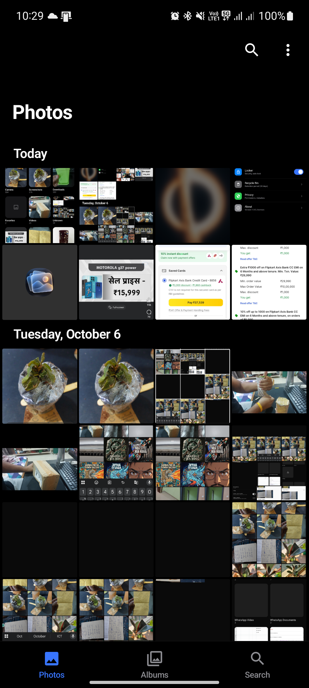
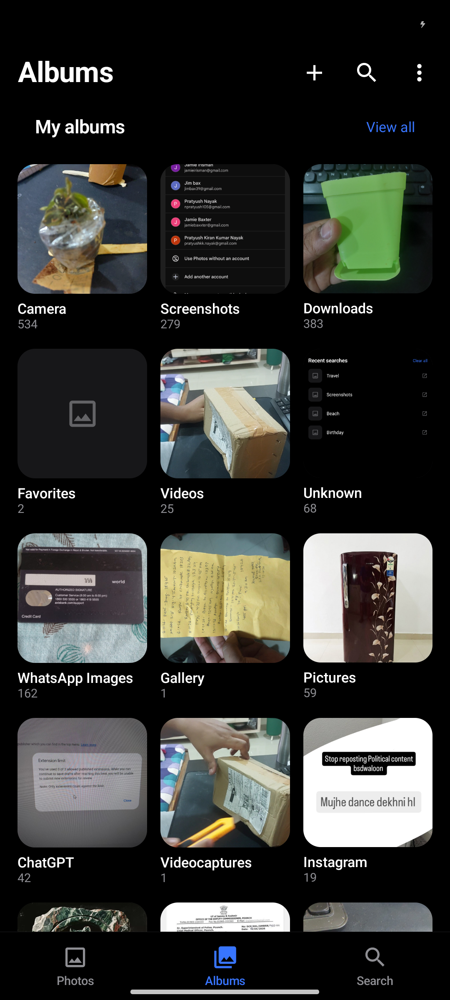
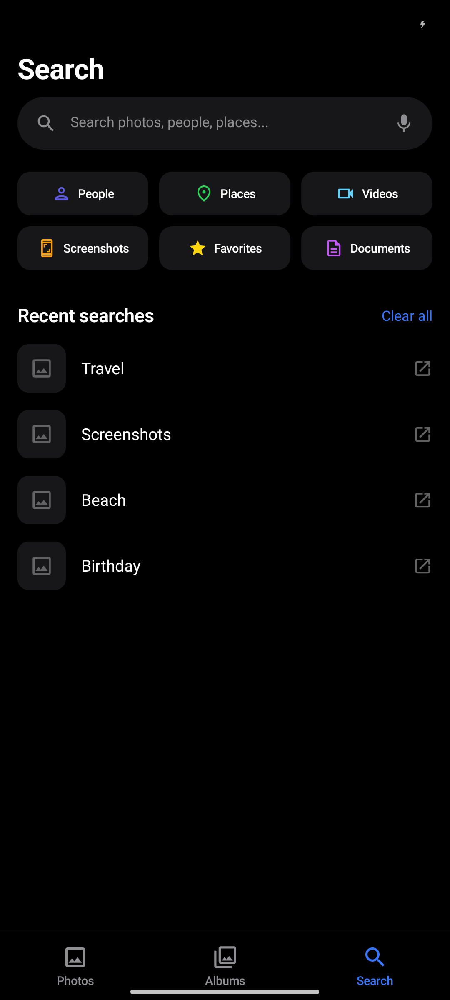
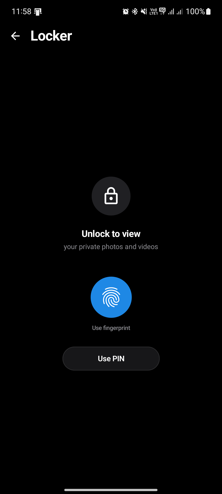

# Gallery — Ultra-Smooth Native Android Gallery

[](https://developer.android.com)
[](https://kotlinlang.org)
[](https://developer.android.com/jetpack/compose)
[](#performance-architecture)
[](LICENSE)

A blazing-fast, fluid, and privacy-focused native Android Gallery application inspired by the **Samsung One UI** design language. Engineered from the ground up for high-refresh-rate displays (**90 Hz** and **120 Hz**) with zero unnecessary main-thread workload, hardware-accelerated 32-bit color rendering, biometric encryption, and gesture-driven navigation.

🌐 **Website & Live Demo**: [https://pratyushkk.github.io/Gallery/](https://pratyushkk.github.io/Gallery/)  
📦 **Download APK**: [Latest Release v1.0.0](https://github.com/pratyushkk/Gallery/releases/latest/download/app-release.apk)

---

## 📱 Screenshots

| Photos (Grid) | Albums | Smart Search | Biometric Vault |
|:---:|:---:|:---:|:---:|
|  |  |  |  |

---

## ✨ Key Features

- **⚡ 90 Hz & 120 Hz High Refresh Performance**:
  - Main thread strictly reserved for lightweight composition, layout, and gesture dispatching.
  - Zero disk I/O, heavy decoding, or crypto on the UI thread.
  - Calculated frame budgets: ~11.1ms for 90Hz, ~8.3ms for 120Hz.

- **🖼️ 32-Bit Razor-Sharp Previews**:
  - Direct bitmap stream decoding with full `ARGB_8888` / `HARDWARE` color depth.
  - Eliminates compressed system micro-thumbnails and AMOLED color banding.
  - Viewport-aware super-sampled thumbnail caching (500px) with multi-tiered LRU memory and disk cache.

- **👆 Fluid Gesture-Driven Navigation**:
  - Horizontal swipe between primary tabs (**Photos $\leftrightarrow$ Albums $\leftrightarrow$ Search**) with synchronized bottom navigation indicator.
  - Fullscreen photo viewer with unconstrained horizontal swiping and deep double-tap/pinch-to-zoom.
  - Real-time animated filmstrip carousel scrubber.

- **🔒 Biometric Secured Locker (Vault)**:
  - Hardware-backed biometric authentication (Fingerprint / Face / PIN) via `BiometricPrompt`.
  - AES-256 GCM encrypted files hidden from other gallery apps and file managers.

- **🗑️ 30-Day Recycle Bin**:
  - Safeguard against accidental media deletions.
  - Automatic expiration and one-tap restore/purge capabilities.

- **🔍 Smart Search & Categorization**:
  - Filter by media type (Photos, Videos, Screenshots, Downloads, Favorites).
  - Search history with persistent Room database storage.

- **⚙️ Dynamic Grid Density**:
  - Switch on the fly between Large (3 columns), Medium (4 columns), and Small (5 columns) with instant relayout.

---

## 🛠️ Tech Stack & Architecture

- **Language**: Kotlin 2.0.21
- **UI Toolkit**: Jetpack Compose (BOM 2024.12.01), Material 3
- **Architecture**: Clean Architecture + MVI/MVVM with Kotlin Coroutines & StateFlow
- **Image Pipeline**: Coil 2.7.0 (Custom high-res fetcher, ARGB_8888, 250MB disk cache)
- **Local Storage**: Android Room 2.6.1 + DataStore Preferences
- **Security**: AndroidX Biometric 1.2.0 + AndroidKeyStore AES-256 GCM
- **Media**: MediaStore ContentObserver + Media3 ExoPlayer

---

## 📥 Installation

Download the signed release APK directly from GitHub Releases:

1. Go to [Releases](https://github.com/pratyushkk/Gallery/releases/latest).
2. Download `app-release.apk`.
3. Open the downloaded file on your Android device (Android 8.0 or newer) and tap **Install**.

Or install via ADB:
```bash
adb install -r app-release.apk
```

---

## 🏗️ Building from Source

### Prerequisites
- JDK 17
- Android SDK (API 35, Build Tools 35.0.0)

### Clone & Build
```bash
git clone https://github.com/pratyushkk/Gallery.git
cd Gallery
./gradlew assembleRelease
```
The compiled APK will be available in:
`app/build/outputs/apk/release/app-release.apk`

---

## 📄 License

Licensed under the Apache License, Version 2.0. See the [LICENSE](LICENSE) file for details.
